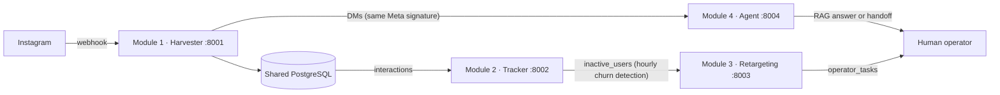

**فارسی** | [English](README.en.md)

<div dir="rtl">

# ایکال (Aykal)

**پلتفرم جذب سرنخ و حفظ مشتری برای کسب‌وکارهای اینستاگرامی.** ایکال کامنت‌ها و دایرکت‌های اینستاگرام را به سرنخ امتیازدار تبدیل می‌کند، کاربرانی را که در حال ریزش‌اند تشخیص می‌دهد و برای اپراتور پیشنهاد اقدام می‌سازد. یک ربات هوشمند مبتنی بر RAG هم به سؤال‌های مشتری پاسخ می‌دهد و در صورت نیاز گفتگو را به انسان ارجاع می‌دهد.

> چهار ماژولی که تیم جداگانه نوشته بود، در **یک پروژه، یک دیتابیس و یک فایل تنظیمات** یکپارچه شده‌اند.

## معماری

</div>



<div dir="rtl">

| # | ماژول | پوشه | کار |
|---|---|---|---|
| ۱ | Harvester | `services/module1_harvester` | دریافت webhook متا، تشخیص نیت، امتیازدهی به سرنخ |
| ۲ | Tracker | `services/module2_tracker` | تشخیص کاربران در حال ریزش و نوشتن در `inactive_users` |
| ۳ | Retargeting | `services/module3_retargeting` | تبدیل کاربران غیرفعال به پیشنهاد برای اپراتور (`operator_tasks`) |
| ۴ | Agent | `services/module4_agent` | گفتگوی هوشمند، پایگاه دانش (RAG) و ارجاع به اپراتور |

فقط ماژول ۱ به آدرس عمومی نیاز دارد؛ دایرکت‌ها را خودش به ماژول ۴ می‌رساند.

## اجرا با Docker

</div>

```bash
git clone https://github.com/TahaFaramarzi/aykal.git
cd aykal
cp .env.example .env        # مقدارها را پر کنید (توضیح در بخش «تنظیمات Meta»)
docker compose up --build
```

<div dir="rtl">

دیتابیس در اولین اجرا خودکار از `db/schema.sql` ساخته می‌شود. برای اجرا بدون Docker از `scripts/run_local.sh` استفاده کنید.

## تست سرتاسری (بدون اینستاگرام واقعی)

وقتی سرویس‌ها بالا هستند:

</div>

```bash
META_APP_SECRET=... API_KEY=... DATABASE_URL=postgresql://... python scripts/e2e_demo.py
```

<div dir="rtl">

این تست یک webhook امضاشده می‌فرستد و کل مسیر را بررسی می‌کند: ساخت سرنخ، ارجاع دایرکت به اپراتور، تشخیص ریزش و ساخت پیشنهاد اپراتور.

تست‌های هر ماژول هم جدا هستند: **ماژول ۱: ۱۹ · ماژول ۲: ۱۲۷ · ماژول ۳: ۲۵ · ماژول ۴: ۳۷**.

## تنظیمات Meta

«شماره‌ی تلفن» فقط برای ساخت حساب Meta for Developers لازم است. بعد از آن:

1. یک حساب اینستاگرام **حرفه‌ای** (Business یا Creator) داشته باشید.
2. در [developers.facebook.com](https://developers.facebook.com) یک App بسازید و محصول **Instagram** را اضافه کنید.
3. مجوزهای پیام و کامنت اینستاگرام (مثلاً `instagram_business_manage_messages` و `instagram_business_manage_comments`) را اضافه کنید.
4. مقدارهای زیر را در `.env` بگذارید:

| متغیر | از کجا |
|---|---|
| `META_APP_SECRET` | App settings ← Basic ← App Secret |
| `WEBHOOK_VERIFY_TOKEN` | یک رشته‌ی دلخواه؛ همان را در داشبورد Meta هم وارد کنید |
| `IG_ACCESS_TOKEN` | توکن حساب حرفه‌ای (برای ارسال پاسخ) |
| `IG_USER_ID` | شناسه‌ی حساب حرفه‌ای |

5. در بخش **Webhooks** آدرس `https://<دامنه‌ی-عمومی-شما>/webhook` را بدهید (برای توسعه از ngrok یا Cloudflare Tunnel استفاده کنید) و فیلدهای `comments` و `messages` (و `mentions`) را Subscribe کنید.

نکته‌ها:
- تا قبل از App Review فقط حساب‌هایی که نقش Tester یا Developer دارند پیام‌ها را می‌فرستند.
- توکن‌های بلندمدت اینستاگرام تاریخ انقضا دارند و باید تمدید شوند.
- نام دقیق مجوزها و فیلدها را با مستندات روز Meta تطبیق دهید. **این یکپارچگی با Meta واقعی امتحان نشده است**؛ تست سرتاسری با webhook امضاشده‌ی آزمایشی انجام می‌شود.

## سیاست پیام‌رسانی (تصمیم مهم طراحی)

- ربات فقط در **پنجره‌ی ۲۴ ساعته** بعد از پیام خود کاربر پاسخ می‌دهد (ماژول ۴ و ویوی `contactable_users`).
- ماژول ۳ هیچ لایک، دیدن استوری یا پیام خودکاری روی اینستاگرام انجام نمی‌دهد. هر اقدام تصمیم‌گیری‌شده (پیام، لایک، …) به **پیشنهاد برای اپراتور** تبدیل می‌شود و انسان تصمیم می‌گیرد.
- استخراج فالوور پیج‌های دیگران و پیام سرد پشتیبانی **نمی‌شود**. برای مخاطب جدید از تبلیغات «کلیک به دایرکت» خود Meta استفاده کنید.

## دیتابیس

اسکیما: `db/schema.sql`. هویت مشترک هر کاربر = `ig_users.user_id` (BIGINT).

جدول‌ها: `ig_users`، `leads`، `interactions`، `engagement_snapshots`، `inactive_users`، `retargeting_actions`، `operator_tasks`، `conversations`، `messages`، `handoffs`، `eval_*`.

## تغییرات نسبت به کدهای اصلی

**همه:** یک `DATABASE_URL` و یک `.env`؛ `requirements.txt` ماژول ۴ از UTF-16 به UTF-8 تبدیل شد (pip نمی‌خواند)؛ فایل‌های `.env` واقعی و venv از پروژه حذف شدند.

**ماژول ۱:** فایل‌های گم‌شده‌ی `llm_service.py` و `api/llm.py` ساخته شد (LLM اختیاری، با fallback کلیدواژه‌ای)؛ مدل‌ها به `ig_users` وصل شد؛ جلوگیری از ثبت تکراری webhook؛ ارسال دایرکت به ماژول ۴؛ رمز پیش‌فرض دیتابیس از کد حذف شد؛ با `META_APP_SECRET` خالی هیچ امضایی پذیرفته نمی‌شود؛ باگ اولویت نیت (شکایت قبل از خرید) درست شد؛ Dockerfile درست شد؛ Alembic حذف شد (اسکیما با `db/schema.sql` مدیریت می‌شود).

**ماژول ۲:** `app/db_sync.py` و `POST /sync/db` اضافه شد (خواندن از `interactions`، نوشتن در `inactive_users`).

**ماژول ۳:** `app/main.py` (API + حلقه‌ی خودکار)، `requirements.txt` کامل، اجرای واقعی به‌جای شبیه‌ساز (`operator_tasks`)؛ شبیه‌سازی خطای کاربرهای ۳۱۰ و ۲۱۰ فقط با `RETARGETING_SIMULATE_FAILURES=true` (برای تست‌ها).

**ماژول ۴:** بدون `OPENAI_API_KEY` دیگر هنگام راه‌اندازی کرش نمی‌کند (فقط ارجاع به اپراتور کار می‌کند).

## محدودیت‌های شناخته‌شده

- پیشنهادهای اپراتور فقط از طریق API در دسترس‌اند (هنوز رابط کاربری ندارند).
- صف و پیش‌نویس JSON ماژول ۲ (`recovery_queue`، `drafts`) هنوز به دیتابیس وصل نشده و در این جریان استفاده نمی‌شود.
- RAG ماژول ۴ (پایگاه دانش و پاسخ هوشمند) به کلید OpenAI و اینترنت نیاز دارد؛ این مسیر به‌صورت سرتاسری اجرا نشده است.
- بررسی دقت ۸۵٪ به مجموعه‌ی سؤال واقعی کاتالوگ نیاز دارد (جدول‌های `eval_*` آماده‌اند).

## نقشه‌ی راه

- [ ] داشبورد رابط کاربری برای اپراتور
- [ ] اتصال صف و پیش‌نویس ماژول ۲ به PostgreSQL
- [ ] ارزیابی دقت RAG روی مجموعه‌ی سؤال واقعی کاتالوگ
- [ ] راستی‌آزمایی یکپارچگی با پلتفرم واقعی Meta

## لایسنس

MIT

</div>
